# Лабораторная работа № 6

## Система контроля версий Git

| Сведения | Значение |
|---|---|
| Дисциплина | Основы программирования |
| Студент | 4515, Румянцев А. Р. |
| Преподаватель | Мустафин Т. Р. |
| Репозиторий | <https://github.com/Ogyod/LR6> |

## Цель работы

Изучить базовые возможности Git и получить практический опыт работы с локальным и удалённым репозиториями, ветками, коммитами и слияниями.

## Ход работы

1. **Аккаунт GitHub.** Использован существующий аккаунт GitHub `Ogyod`.
2. **Форк.** Создан форк [Kurtyanik/LR6](https://github.com/Kurtyanik/LR6) в личном хранилище `Ogyod`, включая исходные ветки.
3. **Установка Git.** Git уже был установлен в macOS, поэтому установка не повторялась. Версия проверена командой `git --version`: `git version 2.50.1 (Apple Git-155)`; текстовая запись находится в `git-version.txt`.
4. **Настройка клиента.** Для локального репозитория заданы имя автора `4515 Румянцев А. Р.` и адрес `mr.ogyod@mail.ru`.
5. **Клонирование.** Форк `Ogyod/LR6` клонирован на компьютер; удалённый репозиторий доступен под именем `origin`.
6. **Добавление и получение файла.** Через веб-интерфейс GitHub в ветку `master` добавлен `web-added-file.txt`. Затем локальный `master` обновлён командой `git pull --ff-only origin master` до коммита `0ffe796`.
7. **История веток.** Командами `git branch -a` и `git log --oneline --decorate --all --graph` просмотрена история `master`, `branch1` и удалённых веток.
8. **Последние изменения.** Командой `git show 0ffe796` просмотрены коммит добавления файла через GitHub и его diff.
9. **Слияние и конфликт.** Локальная ветка `branch1` объединена с `master`. Конфликт `mergefile.txt` разрешён вручную с сохранением пояснений обеих версий; слияние зафиксировано коммитом `fd6f3e5`.
10. **Удаление побочной ветки.** После слияния локальная `branch1` удалена; удалённая `origin/branch1` сохранена.
11. **Изменения и коммиты.** Отдельными коммитами обновлены `notes.txt` и `practice.txt`; временный файл для проверки отката также был добавлен отдельным коммитом.
12. **Откат.** Командой `git revert` отменён коммит временного файла. Первоначальный коммит сохранён в истории, отмена оформлена новым коммитом.
13. **Ветка отчёта.** Создана ветка `report`; в неё включено обновление `master` с файлом `web-added-file.txt`.
14. **README и снимки.** В `README.md` описаны шаги и приведён журнал команд без результатов. 18 изображений из переданного архива помещены в `screenshots/` и встроены ниже. Их платформа и версия Git отдельно оговорены в разделе снимков.
15. **Форматированная история и фиксация.** В отчёт включён граф истории с сокращёнными хэшами, датами, авторами и комментариями. После обновления отчёта и добавления снимков выполнен финальный локальный коммит.
16. **Отправка на GitHub.** Ветка `report` отправлена командой `git push -u origin report`. Коммит `5b5092d` и 18 изображений доступны в GitHub. В личный кабинет ГУАП файлы не загружались. PDF с титульным листом и ссылкой подготовлен отдельно.

## Результат слияния

В `mergefile.txt` сохранены сведения из обеих версий. Коммит слияния: `fd6f3e5`.

## Проверка Git

```text
git --version
git version 2.50.1 (Apple Git-155)
```

Подтверждение сохранено в `git-version.txt`. Это текстовая запись результата команды, а не снимок экрана консоли.

## История операций

Формат: сокращённый хэш, дата, автор и комментарий коммита. Список отражает историю до коммита с фиксацией статуса публикации; этот последний коммит в снимок истории не входит.

```text
* 5b5092d 2026-11-07 4515 Румянцев А. Р. Добавлены снимки экрана в отчёт
* ea145bb 2026-11-07 4515 Румянцев А. Р. Уточнено оформление сведений отчёта
* 9425dfc 2026-11-07 4515 Румянцев А. Р. Обновлена история коммитов в отчёте
* 5bd1ac7 2026-11-07 4515 Румянцев А. Р. Уточнён статус отчёта и публикации
* c56291a 2026-11-07 4515 Румянцев А. Р. Завершён отчёт по лабораторной работе 6
*   3cf8189 2026-11-07 4515 Румянцев А. Р. Merge branch 'master' into report
|\
| * 0ffe796 2026-11-07 Ogyod Добавлен файл через веб-интерфейс GitHub
* | ed8cd91 2026-11-07 4515 Румянцев А. Р. Уточнена история веток и шаг pull
* | 1c2e3ab 2026-11-07 4515 Румянцев А. Р. Отражён шаг добавления файла через GitHub
* | 7cfd921 2026-11-06 4515 Румянцев А. Р. Уточнены результаты и состав отчёта
* | 17fa195 2026-11-06 4515 Румянцев А. Р. Добавлена история коммитов в отчёт
* | a68dc0e 2026-11-06 4515 Румянцев А. Р. Добавлен журнал команд и оформление отчёта
* | 15292d4 2026-11-06 4515 Румянцев А. Р. Уточнён отчёт и проверка Git
* | 7ec3bee 2026-11-06 Ogyod Добавлена проверка установленного Git
* | 99cb54d 2026-11-06 Ogyod Добавлен отчёт по лабораторной работе 6
|/
* d488599 2026-11-06 Ogyod Revert "Создан временный файл для проверки отката"
* b5aefe8 2026-11-06 Ogyod Добавлен перечень шагов лабораторной
* ffcaf1d 2026-11-06 Ogyod Создан временный файл для проверки отката
* 90757dd 2026-11-06 Ogyod Добавлены заметки по истории веток
*   fd6f3e5 2026-11-06 Ogyod Разрешён конфликт слияния branch1 в master
|\
| * 0f9f50d 2020-11-21 Kurtyanik Заполнил файл
* | 921f53b 2020-11-21 Kurtyanik Обновление информации
|/
* c08a654 2020-11-21 Kurtyanik Файл создан пустым
* 3c6e913 2020-11-21 Kurtyanik Initial commit
```

## Журнал команд

Команды приведены без результатов выполнения.

```bash
git clone https://github.com/Ogyod/LR6.git
git branch -a
git log --oneline --decorate --all --graph
git show 0ffe796
git config user.name "4515 Румянцев А. Р."
git config user.email "mr.ogyod@mail.ru"
git switch -c branch1 --track origin/branch1
git switch master
git merge --no-edit branch1
git add mergefile.txt
git commit -m "Разрешён конфликт слияния branch1 в master"
git branch -d branch1
git add notes.txt
git commit -m "Добавлены заметки по истории веток"
git add temporary.txt
git commit -m "Создан временный файл для проверки отката"
git add practice.txt
git commit -m "Добавлен перечень шагов лабораторной"
git revert --no-edit ffcaf1d
git switch -c report
git log --all --date=short --pretty=format:"%h %ad %an %s" --graph
git --version
git switch master
git pull --ff-only origin master
git switch report
git merge --no-edit master
git log --all --date=short --pretty=format:"%h %ad %an %s" --graph
git push -u origin report
```

## Снимки экрана

В каталог `screenshots/` добавлены все 18 изображений из переданного архива. Перечень и назначение:

| Файл | Что показывает |
|---|---|
| `00_github_repository.jpg` | Страница форка Ogyod/LR6 в GitHub. |
| `01_git_status.png` | Проверка версии Git и локального статуса. |
| `02_github_file.jpg` | Файл web-added-file.txt в GitHub. |
| `03_git_pull.png` | Получение web-added-file.txt командой git pull. |
| `04_git_branches_log.png` | Список веток и их история. |
| `05_git_show.png` | Просмотр коммита с веб-файлом. |
| `06_branch1.png` | Содержимое исходной ветки branch1. |
| `07_master_branch.png` | Содержимое ветки master перед слиянием. |
| `08_merge_conflict.png` | Конфликт слияния в mergefile.txt. |
| `09_conflict_resolution.png` | Разрешённый конфликт и итоговый файл. |
| `10_merge_completed.png` | Проверка созданного merge-коммита. |
| `11_branch_deleted.png` | Удаление локальной ветки branch1. |
| `12_first_commit.png` | Первый отдельный коммит с изменением notes.txt. |
| `13_next_commits.png` | Последующие коммиты с файлами практики и временным файлом. |
| `14_revert_commit.png` | Отмена коммита временного файла через git revert. |
| `15_report_branch.png` | Создание и проверка ветки report. |
| `16_formatted_history.png` | Форматированный граф истории коммитов. |
| `17_report_github.jpg` | README отчёта в GitHub. |

**Проверка соответствия:** снимки консоли имеют заголовок `Git / Windows` и показывают `git version 2.56.0.windows.2`. В локальной записи `git-version.txt` указана версия `2.50.1 (Apple Git-155)`. Поэтому архивные консольные изображения относятся к Windows и не подтверждают работу именно в macOS. В архиве также нет отдельного снимка команды клонирования. Для отчёта эти материалы сохранены без изменений и привязаны к пунктам по их содержанию; несовпадение платформы не скрывается.

<details>
<summary>GitHub: репозиторий и веб-файл</summary>

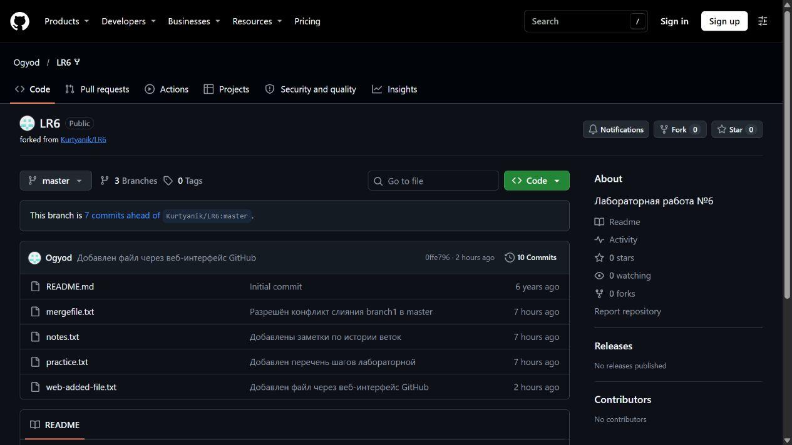

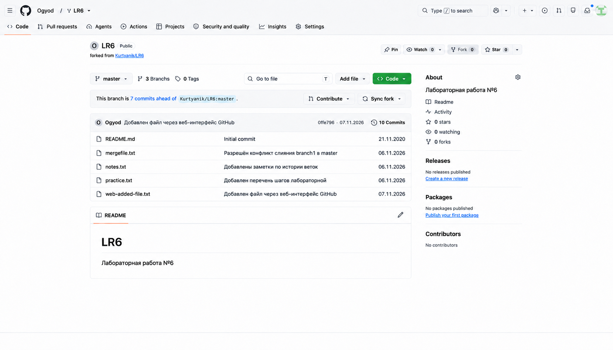

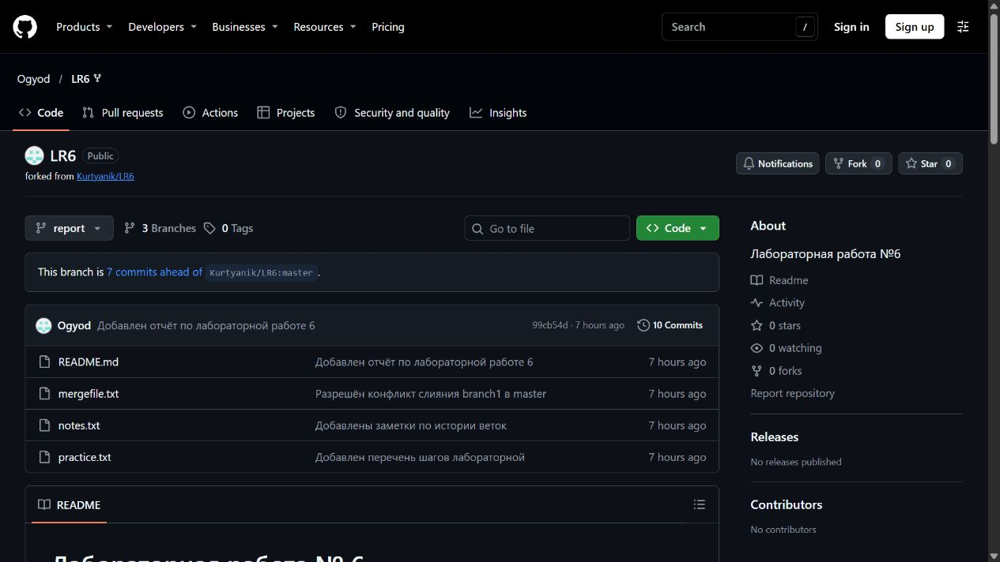

</details>

<details>
<summary>Проверка Git и получение изменений</summary>

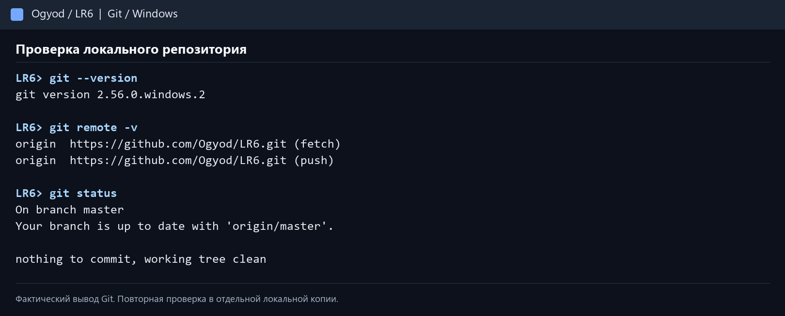

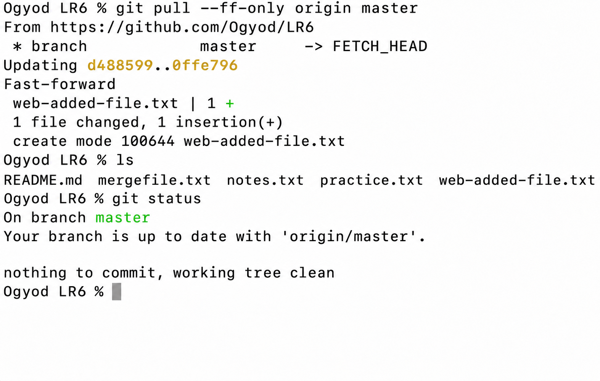

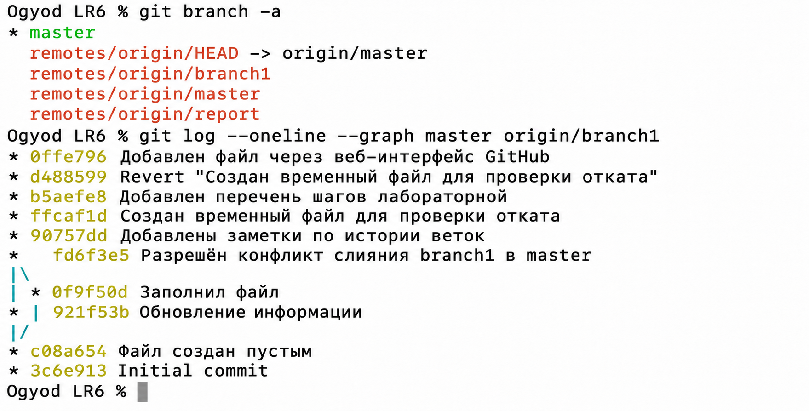

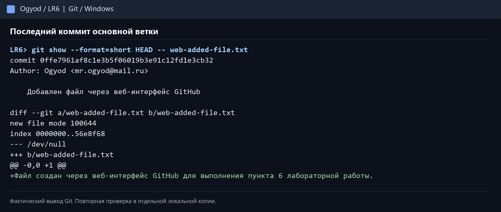

</details>

<details>
<summary>Ветки, конфликт и слияние</summary>

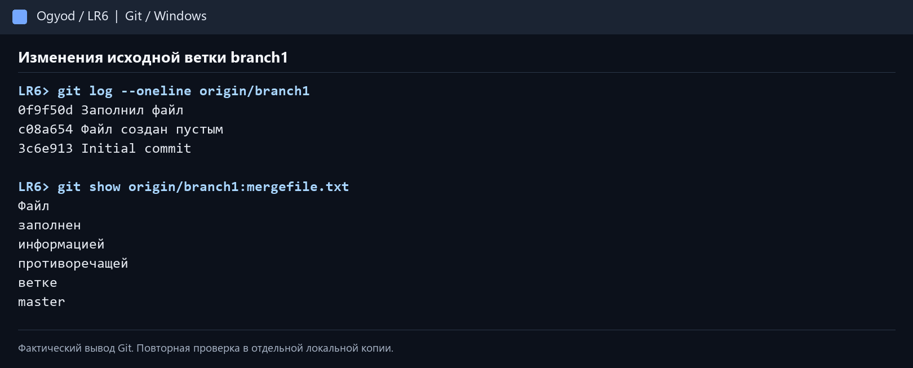

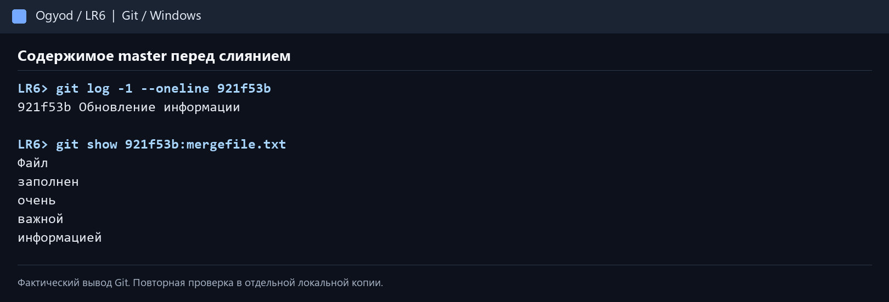

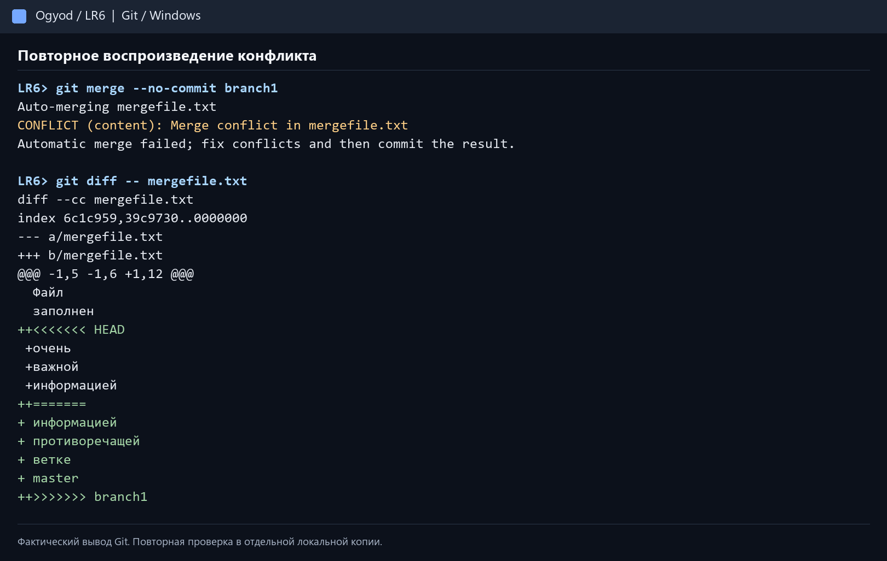

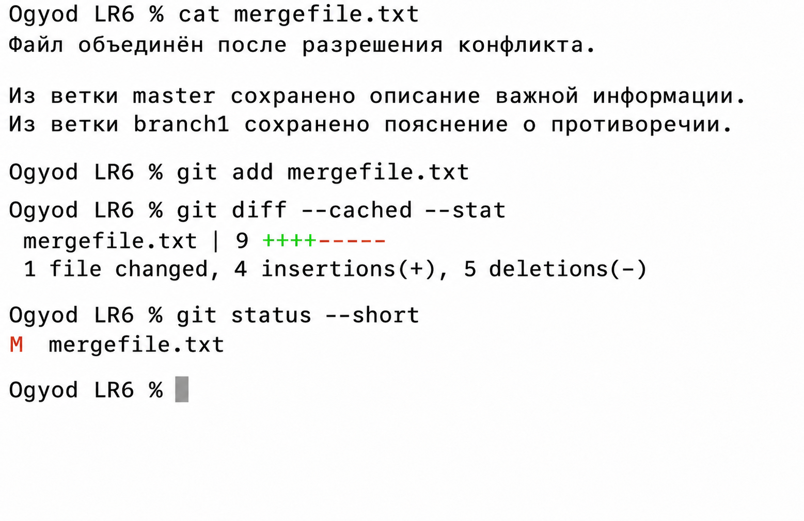

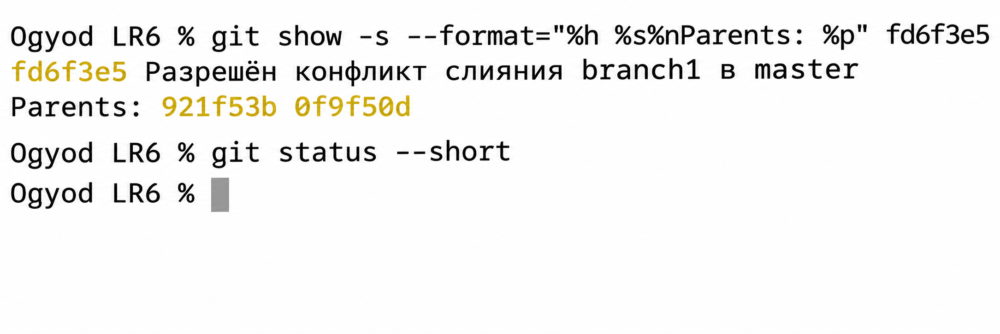

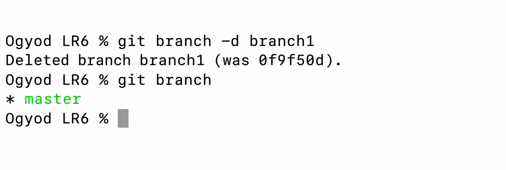

</details>

<details>
<summary>Коммиты, откат и отчёт</summary>

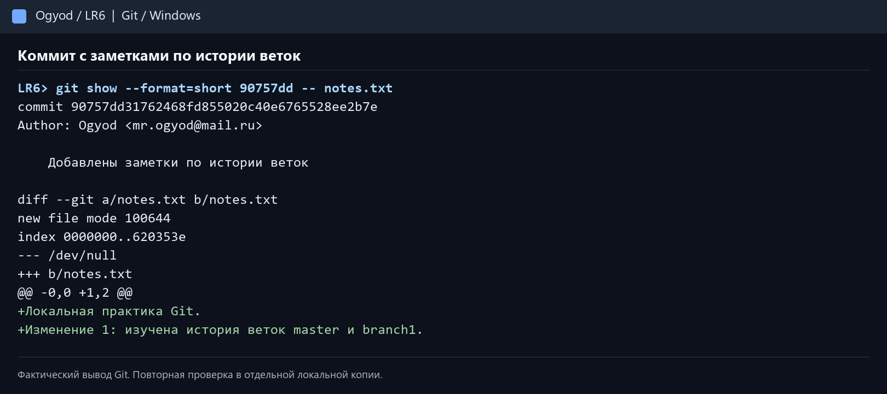

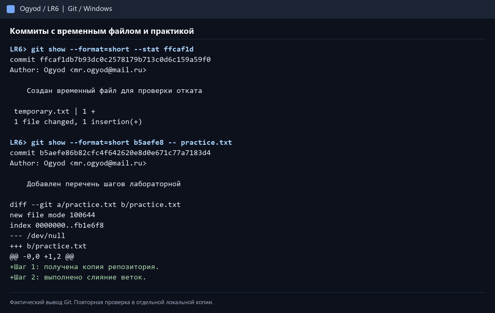

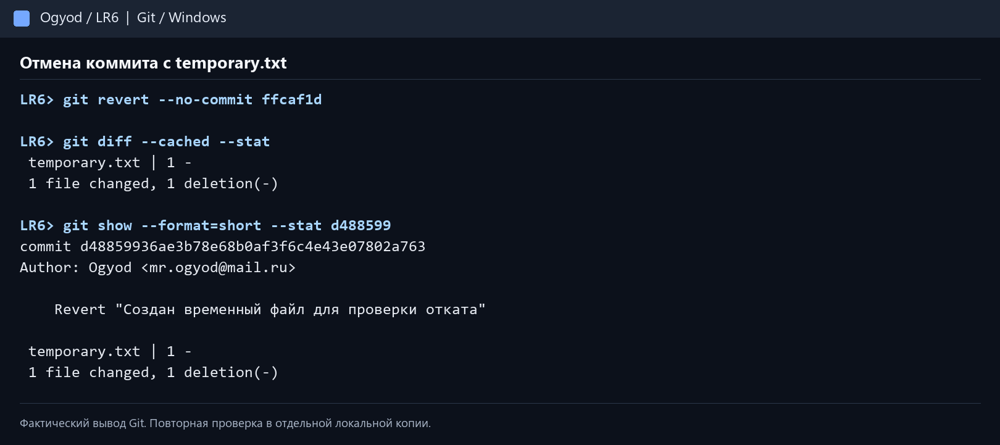

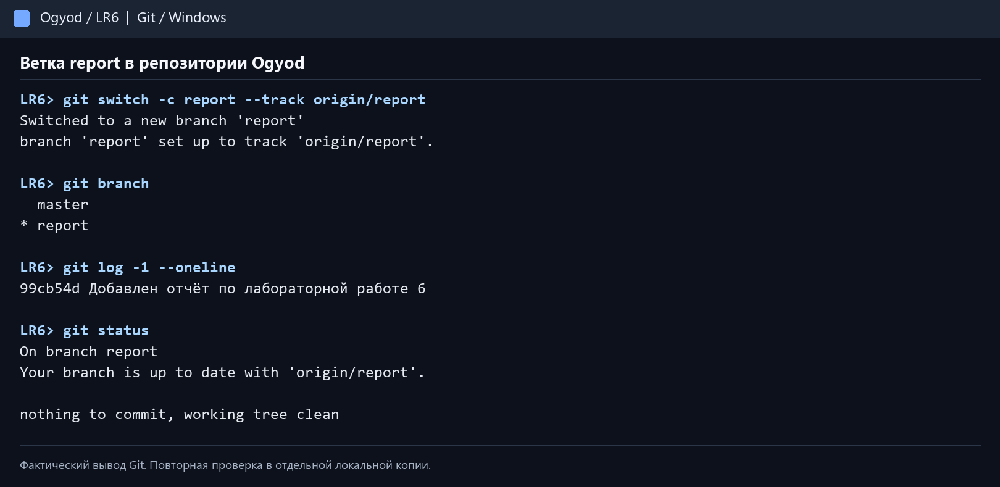

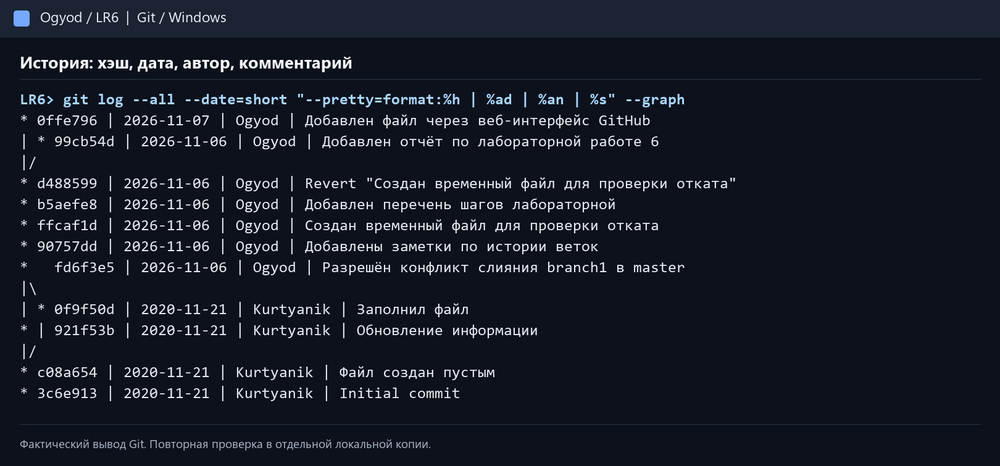

</details>

## Статус синхронизации

Ветка `report` отправлена на GitHub и синхронизирована с `origin/report`. В удалённой ветке размещены README и все 18 снимков в `screenshots/`. Ветка `master` синхронизирована с `origin/master`. В личный кабинет ГУАП ничего не загружалось.

## Заключение

В ходе работы изучены форк и клонирование репозитория, просмотр истории, разрешение конфликта при слиянии, удаление побочной ветки, создание коммитов и откат изменения. PDF с титульным листом и ссылкой на репозиторий подготовлен отдельно.
